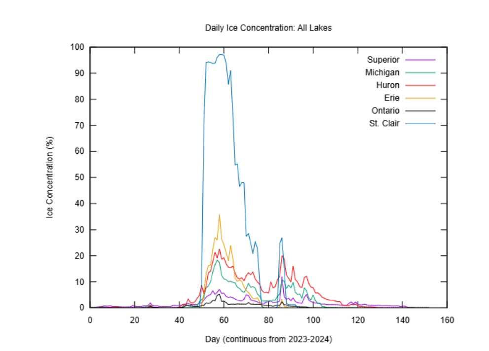
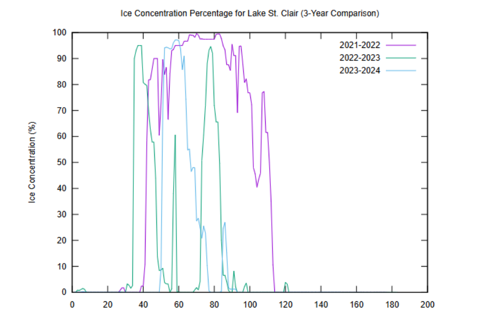

**Report (PDF):** [Great_Lakes_Ice_Report.pdf](docs/Great_Lakes_Ice_Report.pdf)

# Great Lakes Ice Concentration Analysis (C / Gnuplot)

A C program that reads daily winter ice concentration data for six Great Lakes (Superior, Michigan, Huron, Erie, Ontario, St. Clair), computes statistics, and generates trend graphs with Gnuplot. Built for CPS 188 at Toronto Metropolitan University.

## What's inside

- **Yearly averages:** per-lake and Great Lakes total averages for 2023 and 2024
- **Extremes:** which lake has the largest and smallest average ice coverage
- **Peak finder:** highest ice percentage per lake, with the year and day it occurred
- **Three-year comparison:** yearly averages for 2021, 2022, and 2023 using 2D arrays
- **Graphs:** one plot per lake, one combined plot, and 3-year comparison plots

## Project Structure

- `src/` → C source code
- `data/` → raw and cleaned data files
- `gnuplot/` → Gnuplot scripts
- `images/` → program output and graphs
- `docs/` → report PDF

## Sample Results

| Lake | 2023 avg (%) | 2024 avg (%) |
|---|---|---|
| Superior | 0.559 | 2.131 |
| Michigan | 0.114 | 3.423 |
| Huron | 0.139 | 6.025 |
| Erie | 0.002 | 3.296 |
| Ontario | 0.039 | 0.643 |
| St. Clair | 0.024 | 15.245 |

Lake St. Clair reached the highest ice concentration in the dataset (97.15%, 2024, days 21 and 22).

### Combined Ice Concentration Plot

### Lake St. Clair 3-Year Comparison

## How to Run

1. Compile: `gcc src/main.c -o ice_analysis`
2. Run: `./ice_analysis`
3. Plot: `gnuplot -persist gnuplot/all_lakes.gp`

## Tools Used

- C
- Gnuplot
- Data processing with arrays and loops

## Team

Group project with Christopher Michalopoulos and Hesham El Shafie.
